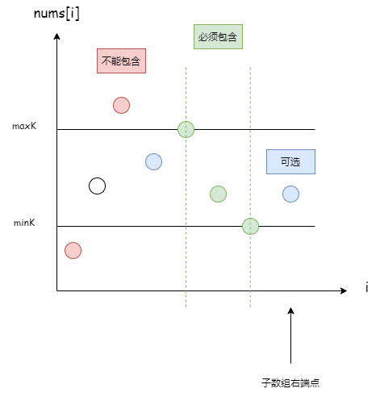

# 哪懂什么算法，全是靠刷

## 数学

- 排列：`A(m, n) = n!/(n-m)!`
- 组合：`A(m, n) = n!/(m!(n-m)!)`

## 离线查询

在线查询：请求来一个，立即处理并回答一个。

离线查询：把所有请求收集起来，统一处理，统一回答。

## 离散化思想

在不改变数据相对大小的条件下，对数据进行相应的缩小。

## 树状数组

## 最大化最小值、最小化最大值

二分答案

[2517. 礼盒的最大甜蜜度](https://leetcode.cn/problems/maximum-tastiness-of-candy-basket/)

## 正难则反（逆向思维）

`正向求解 = 总数 - 反向求解`

## 贡献思维

`求所有方案数` 转化为 `求每个元素的贡献值的总和`

[2475. 数组中不等三元组的数目](https://leetcode.cn/problems/number-of-unequal-triplets-in-array/description/)

## 分解质因数

```python
while i * i <= n:
	while n % i == 0:
    	# print(i)
		n //= i
	i += 1
```

## 差分数组

1. 多次操作：一个区间内的数都加1
2. 操作完了，需要看一下每个数变成多少了

```c
# 初始数组
[0, 0, 0, 0, 0]

# 区间[1,3]都加上1，把开始的地方+1，在结束的地方-1
[0, 1, 0, 0, -1]

# 区间[0, 1]都加上1，把开始的地方+1，在结束的地方-1
[1, 1, -1, 0, -1]

# 结果，求前缀和
[1, 2, 1, 1, 0]
```

## 二分查找

```python
# 返回有序数组中第一个 >= target的位置。如果都小于target，返回数组长度。
def lower_bound(nums: List[int], target: int) -> int:
    # 闭区间 [left, right]
    left = 0
    right = len(nums) - 1

    while left <= right:
        mid = left + (right - left) // 2
        if nums[mid] < target:
            left = mid + 1
        else:
            right = mid - 1
    return left

# 三种区间
# [left, right]
# [left, right)
# (left, right)
# 上面代码稍微改动即可

def lower_bound2(nums: List[int], target: int) -> int:
    # 左闭右开 [left, right)
    left = 0
    right = len(nums)

    while left < right:
        mid = left + (right - left) // 2
        if nums[mid] < target:
            left = mid + 1
        else:
            right = mid
    return left  # 返回right也可以

def lower_bound3(nums: List[int], target: int) -> int:
    # 开区间 (left, right)
    left = -1
    right = len(nums)

    while left + 1 < right:
        mid = left + (right - left) // 2
        if nums[mid] < target:
            left = mid
        else:
            right = mid
    return right

# 四种情况：
# >= x      获取第一个 >= x的位置
# > x       可以转换成 >= (x+1)
# < x       可以转换成 (>= x) - 1；表示第一个>=x位置的左边位置
# <= x      可以转换成 (> x) - 1；表示第一个>x位置的左边位置；>x还可以继续转换

# 举例：
# 获取有序数组中目标值target的第一个位置和最后一个位置（假设存在target）
start = lower_bound(nums, target)        # >= x
end = lower_bound(nums, target+1) - 1    # <= x
```

```python
from bisect import *

# bisect_left 查找第一个大于等于target的位置
# bisect 查找第一个大于target的位置
# bisect_right 查找第一个大于target的位置
```

## 01背包

```python
dp = [0]*(target+1)
# 求有多少种方法
# dp[0] = 1
for i in range(len(nums)):
	for j in range(target, nums[i]-1, -1):
		# 求最大价值
		dp[j] = max(dp[j], dp[j-weight[i]]+value[i])
		# 求有多少种方法
		# dp[j] += dp[j-nums[i]]
return dp[target]
```

## 完全背包

唯一的区别就是背包的遍历顺序：01背包是要求倒序，完全背包是正序

```python
for n in nums:  # 遍历物品
	for j in range(n, target+1):  # 遍历背包
		# 求最大价值
		# 求有多少种方法
```

### 先遍历物品

由于先遍历的物品，会得到物品的**组合**。

比如物品[1,2,3]，背包容量为3。先遍历1，后遍历2，得到组合[1,2]。

```python
for n in nums:  # 遍历物品
	for j in range(c, target+1):  # 遍历背包
```

### 先遍历背包

由于先遍历的背包，会得到物品的**排列**。

比如物品[1,2,3]，背包容量为3。既能得到[1,2]，又能得到[2,1]。

```python
for j in range(0, target+1):  # 遍历背包
	for n in nums:  # 遍历物品
```

## 多重背包

```python
dp = [0]*(target+1)
# 求有多少种方法
dp[0] = 1
# 每个物品的价值是value，数量有count个
for count, value in nums:
	for i in range(target, 0, -1):
		for j in range(1, count+1):
			if i - j*value >= 0:
				# 求有多少种方法
				dp[i] += dp[i-j*value]
return dp[target]
```
[6310. 获得分数的方法数](https://leetcode.cn/contest/weekly-contest-335/problems/number-of-ways-to-earn-points/)

## 判断一个数是否是2的幂次方

```python
x & (x-1) == 0
```

## 取模

取模过程只能乘、加、减，而除法取模只能使用逆元进行操作。

```python
(a + b) % MOD == a % MOD + b % MOD
```

[6368. 找出字符串的可整除数组](https://leetcode.cn/problems/find-the-divisibility-array-of-a-string/)

## 前后缀分解

[1653. 使字符串平衡的最少删除次数](https://leetcode.cn/problems/minimum-deletions-to-make-string-balanced/description/)

## 区间排序

在求多个区间`[start, end]`的重叠情况时，可以进行按`左端点` 或 `右端点` 排序来统计。

这里有一个性质：**如果按`右端点` 排序，前面一个区间和后面一个区间如果存在交集，那么这个交集一定是前面区间的一个后缀。**

## 限定边界的子数组

**限定边界的情况下，统计满足条件的子数组**，这类问题，可以通过在二维坐标里面画图，来分析思路。

[795. 区间子数组个数](https://leetcode.cn/problems/number-of-subarrays-with-bounded-maximum/description/)

[2444. 统计定界子数组的数目](https://leetcode.cn/problems/count-subarrays-with-fixed-bounds/description/)



## 反转链表

```python
## 递归法
class Solution:
    def reverseList(self, head: Optional[ListNode]) -> Optional[ListNode]:
        if head is None or head.next is None: return head
        newHead = self.reverseList(head.next)
        head.next.next = head
        head.next = None
        return newHead

## 迭代法
class Solution:
    def reverseList(self, head: Optional[ListNode]) -> Optional[ListNode]:
        pre = None
        cur = head
        while cur:
            nxt = cur.next
            cur.next = pre
            pre = cur
            cur = nxt
        return pre
```

## 快排

### 快排

```python
def partition(self, nums, left, right):
    pivot = left
    j = pivot+1
    for i in range(j, right+1):
        if nums[i] < nums[pivot]:
            nums[i], nums[j] = nums[j], nums[i]
            j += 1
    nums[pivot], nums[j-1] = nums[j-1], nums[pivot]
    return j-1

def quickSort(self, nums, left, right):
    if left < right:
        p = self.partition(nums, left, right)
        self.quickSort(nums, left, p-1)
        self.quickSort(nums, p+1, right)
```

### 随机化版本

```python
def randomPartition(self, nums, left, right):
    i = random.randint(left, right)
    nums[i], nums[left] = nums[left], nums[i]
    return self.partition(nums, left, right)

def randomQuickSort(self, nums, left, right):
    if left < right:
        p = self.randomPartition(nums, left, right)
        self.randomQuickSort(nums, left, p-1)
        self.randomQuickSort(nums, p+1, right)
```

### 数组中的第K个最大元素

```python
# 快排分区思想：找出一个数的正确位置，使得左边比它小，右边比它大
# 要找出第k大的元素，快排按降序排序，找到第k-1的位置
# partition写成降序

def randomPartitionWithK(self, nums, left, right, k):
    if left >= right:
        return
    # 获取随机位置
    i = random.randint(left, right)
    nums[i], nums[left] = nums[left], nums[i]
    index = partition(nums, left, right)
    # 如果位置大于k，则在左边继续分区
    # 如果位置小于k，则在右边继续分区
    # 如果位置等于k，则停止分区
    if index > k: self.randomPartitionWithK(nums, left, index-1, k)
    elif index < k: self.randomPartitionWithK(nums, index+1, right, k)

def findKthLargest(self, nums: List[int], k: int) -> int:
    self.randomPartitionWithK(nums, 0, len(nums)-1, k)
    return nums[k-1]
```

## 回溯

回溯三要素：`路径`、`选择列表`、`结束条件`。

```python
result = []
path = []

def backtrack():
    if 满足结束条件:
        result.append(path[:])  # 拷贝一份，避免被后续修改
        return
    for 选择 in 选择列表:
        if 不合法: continue  # 剪枝
        path.append(选择)  # 做选择
        backtrack()
        path.pop()  # 撤销选择

backtrack()
```

### 子集型

特点：

- 两种写法：选或不选、答案视角（枚举下一个选谁）
- 答案视角需要 `start` 防止重复，每个节点都是一个答案

[78. 子集](https://leetcode.cn/problems/subsets/)

【写法一】选或不选：

```python
res = []

def backtrack(track: list[int], i: int):
    if i == len(nums):
        res.append(track.copy())
        return
    # 不选 nums[i]
    backtrack(track, i+1)
    # 选 nums[i]
    track.append(nums[i])
    backtrack(track, i+1)
    track.pop()

track = []
backtrack(track, 0)
```

【写法二】答案视角：

```python
res = []

def backtrack(track: list[int], start: int):
    res.append(track.copy())  # 每个节点都是一个答案
    for i in range(start, len(nums)):
        track.append(nums[i])
        backtrack(track, i+1)
        track.pop()

track = []
backtrack(track, 0)
```

### 组合型

特点：

- 需要一个 `start` 防止重复，从 `start` 开始枚举
- 长度等于 `k` 的约束
- 剩余元素不足时，可以剪枝

[77. 组合](https://leetcode.cn/problems/combinations/)

```python
res = []

def backtrack(track: list[int], start: int):
    if len(track) == k:
        res.append(track.copy())
        return

    for i in range(start, n+1):
        track.append(i)
        backtrack(track, i+1)
        track.pop()

track = []
backtrack(track, 1)
```

### 排列型

特点：

- 需要一个 `used` 数组标记已选元素，防止重复使用
- 长度等于 `len(nums)` 的约束
- 每次都从头开始枚举

[46. 全排列](https://leetcode.cn/problems/permutations/)

```python
res = []

def backtrack(track: list[int], used: list[bool]):
    if len(track) == len(nums):
        res.append(track.copy())
        return

    for i in range(len(nums)):
        if used[i]:
            continue
        used[i] = True
        track.append(nums[i])
        backtrack(track, used)
        track.pop()
        used[i] = False

track = []
used = [False] * len(nums)
backtrack(track, used)
```

## 并查集

```python3
class UnionFind:
    def __init__(self, n):
        # 记录每个节点的父节点，初始时每个节点自成一个集合
        self.parent = list(range(n))
        # 记录每棵树的大小（节点数），用于按大小合并
        self.size = [1] * n
        # 连通分量的个数
        self.cnt = n

    def find(self, x: int):
        # 返回x的根节点（支持路径压缩）
        while self.parent[x] != x:
            self.parent[x] = self.parent[self.parent[x]]
            x = self.parent[x]
        return x

    def union(self, x: int, y: int) -> bool:
        # 将x和y连通，返回是否真的发生了合并
        rootX = self.find(x)
        rootY = self.find(y)
        if rootX == rootY:
            return False
        
        # 按大小合并：小树挂到大树下面，保证树高为 O(log n)
        if self.size[rootX] < self.size[rootY]:
            rootX, rootY = rootY, rootX
        self.parent[rootY] = rootX
        self.size[rootX] += self.size[rootY]
        # 把连通分量减一
        self.cnt -= 1
        return True
    
    def connected(self, x: int, y: int):
        # 判断x和y是否连通
        rootX = self.find(x)
        rootY = self.find(y)
        return rootX == rootY
    
    def get_count(self) -> int:
        # 返回连通分量个数
        return self.cnt
```

### 复杂度与要点

- 路径压缩 + 按大小合并，均摊时间复杂度 `O(α(n))`，可以近似看作 `O(1)`。
- `find` 用**迭代**（路径减半）而不是递归，避免 Python 递归深度限制。
- `parent` 初始化为 `list(range(n))`，一开始每个节点自成一个集合。
- 只有 `union` 真正合并了两个集合时，`cnt` 才会减一。

### 常见技巧

1. **只能加边，不能删边**：遇到删边/删点的题，考虑**逆向思维**、离线倒序处理，把删除变成添加。[803. 打砖块](https://leetcode.cn/problems/bricks-falling-when-hit/)
2. **判环**：遍历无向图的边，如果一条边的两个端点已经连通，这条边就会形成环。[684. 冗余连接](https://leetcode.cn/problems/redundant-connection/)
3. **二维坐标转一维**：网格题把 `(i, j)` 映射成 `i * m + j`。[305. 岛屿数量 II](https://leetcode.cn/problems/number-of-islands-ii/)
4. **维护集合信息**：集合大小、最大值、最小值等信息挂在根节点上，合并时一起更新（模板里的 `size` 就是集合大小）。
5. **Kruskal 最小生成树**：边按权值排序，用并查集判断两端是否已连通，不连通就选这条边。[1584. 连接所有点的最小费用](https://leetcode.cn/problems/min-cost-to-connect-all-points/)
6. **合并顺序不影响结果**，可以边读入边合并。

### 带权并查集

每个节点额外维护 `weight[x]`，表示 `x` 到 `parent[x]` 的权值（比如倍数关系）。`find` 回溯时把路径上的权值累乘到根，就能在压缩路径的同时维护关系。

[399. 除法求值](https://leetcode.cn/problems/evaluate-division/)

```python
class WeightedUnionFind:
    def __init__(self, n):
        self.parent = list(range(n))
        # weight[x] 表示 x / parent[x] 的值
        self.weight = [1.0] * n

    def find(self, x: int) -> int:
        # 递归写法：先找到根，回溯时累乘权值并压缩路径
        if self.parent[x] != x:
            root = self.find(self.parent[x])
            self.weight[x] *= self.weight[self.parent[x]]
            self.parent[x] = root
        return self.parent[x]

    def union(self, x: int, y: int, w: float):
        # 已知 x / y = w，合并 x、y 所在集合
        rootX, rootY = self.find(x), self.find(y)
        if rootX == rootY:
            return
        # 令 parent[rootX] = rootY，则 rootX / rootY = w * weight[y] / weight[x]
        self.parent[rootX] = rootY
        self.weight[rootX] = w * self.weight[y] / self.weight[x]

    def query(self, x: int, y: int) -> float:
        # 查询 x / y，先 find 把 weight 累计到根
        rootX, rootY = self.find(x), self.find(y)
        if rootX != rootY:
            return -1.0
        return self.weight[x] / self.weight[y]
```

> 带权并查集的 `find` 用递归写最直观；数据量大时注意递归深度（可调整 `sys.setrecursionlimit`，或改成显式栈）。

### 种类并查集（扩展域）

当元素要分成 `k` 类、并且存在"同类 / 异类"关系时，把每个元素拆成 `k` 个点：`x`、`x+n`、`x+2n`……，再把关系转成合并操作。

例如判断二分图（每个点属于 A 或 B），开 `2n` 个点：

```python
# x 表示"x 属于 A"，x+n 表示"x 属于 B"
uf = UnionFind(2 * n)

# x 和 y 不能在同一集合：x 与 y+n 合并，y 与 x+n 合并
uf.union(x, y + n)
uf.union(y, x + n)

# 若某个 x 满足 find(x) == find(x+n)，说明矛盾（x 同时属于 A 和 B）
```

[886. 可能的二分法](https://leetcode.cn/problems/possible-bipartition/)；更复杂的关系（如"食物链"的三类关系）开 `3n` 个点即可。
