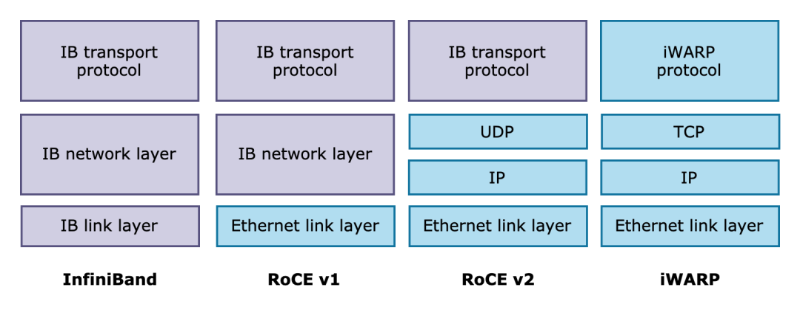
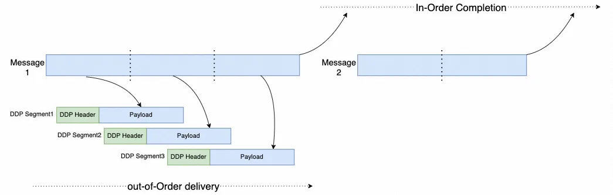
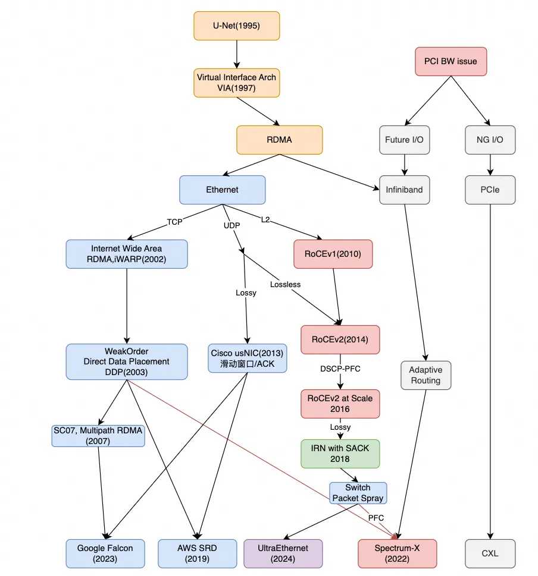

# 初识 RDMA

RDMA（ Remote Direct Memory Access ）意为远程直接地址访问，通过RDMA，本端节点可以“直接”访问远端节点的内存。所谓直接，指的是可以像访问本地内存一样，绕过传统以太网复杂的TCP/IP网络协议栈读写远端内存，而这个过程对端是不感知的，而且这个读写过程的大部分工作是由硬件而不是软件完成的。

## 协议

RDMA本身指的是一种技术，具体协议层面，包含：

- Infiniband（IB）
- RDMA over Converged Ethernet（RoCE）
- Internet Wide Area RDMA Protocol（iWARP）

### IB

规定了一整套完整的链路层到传输层规范，但是其无法兼容现有以太网。想要部署起来需要：支持IB的网卡、配套交换设备。

### RoCE

基于以太网链路层的协议

- v1：网络层使用了IB规范，
- v2：网络层使用了UDP+IP，使得数据包也可以被路由

### iWARP (Internet Wide Area RDMA Protocol)

基于TCP，相比于RoCE v2和IB具有更好的可靠性，从性能上看iWARP比它们差。

## 玩家

标准生态组织：

- IBTA：负责开发、维护和增强Infiniband协议标准。
- OFA：负责开发和维护Infiniband协议和上层应用API。OFED（OpenFabrics Enterprise Distribution）软件栈包括驱动、内核、中间件和API。

开发社区：

- Linux社区：RDMA子系统，内核drivers/infiniband/目录下，包括框架核心代码和各厂商的驱动代码。
- RDMA社区：rdma-core（用户态核心代码，API，文档以及各个厂商的用户态驱动）、perftest（测试RDMA性能的工具）
- UCX：一个建立在RDMA等技术之上的用于数据处理和高性能计算的通信框架。<https://github.com/openucx/ucx>

硬件厂商：

- Mellanox、华为、Intel，博通、Marvell，富士通

## RDMA 的优势

- Zero-copy：指的是不需要在用户空间和内核空间中来回复制数据。
- Kernel bypass：指的是IO（数据）流程可以绕过内核，即在用户层就可以把数据准备好并通知硬件准备发送和接收。避免了系统调用和上下文切换的开销。
- CPU卸载：指的是可以在远端节点CPU不参与通信的情况下（当然要持有访问远端某段内存的“钥匙”才行）对内存进行读写，这实际上是把报文封装和解析放到硬件中做了。
- Message based transactions：基于消息的事务，可在不同的连接上同时执行多个事务，而无需等待任何事务完成。
- Scatter/gather entries support：支持分散/聚集条目，可在单个操作中传输多个缓冲区，而无需将它们合并到单个缓冲区中。

## Verbs

Verbs 是对为使用 RDMA 的应用程序提供的功能的抽象描述：

- Verbs 不是 API
- Verbs 有多种实现

Verbs 可以被分为两大类：

- **控制**：管理资源，通常需要切换上下文（创建/销毁/修改/查询/处理事件）
- **数据**：使用资源发送/接收数据，不需要切换上下文（发送 Send、接收 Receive、轮询 CQ、请求完成事件）

Verbs 是对 RDMA 编程的底层描述，旨在提供延迟、带宽、消息速率等方面的最佳性能。它可以被视作许多应用构建的基石：

- Sockets
- 存储
- 并行计算

InfiniBand 规范以 Verbs 接口形式编写：

- 所需行为的语义描述
- 没有语法或操作系统特定的详细信息
- 可以自由定义实现（函数、结构、类型等的语法）

## OFA Verbs API

一种 Verbs 接口，由 OpenFabrics Alliance（OFA）组织定义和推广。OFA Verbs 是基于 RDMA Verbs 的扩展，提供了更加统一和标准化的 RDMA 编程接口，是 RDMA 领域的一个重要标准，被广泛应用于高性能计算、数据中心和云计算等领域。

- 旨在提供一个开放、跨平台的 RDMA 编程接口，使应用程序能够在不同的 RDMA 硬件和操作系统上进行移植和开发
- OFA 统一 InfiniBand 市场的战略
- OFA 面向 Linux、FreeBSD、Windows 等操作系统实现
- 应用程序的软件接口：支持 C/C++ 程序的数据结构、函数原型
- 用户态空间和内核态空间的变体：大多数应用程序和库都在用户态空间中
- 客户端-服务器编程模型
  - 与 TCP/IP 套接字有一些明显的相似之处
  - 许多其它不同之处，则是由于 RDMA 与 TCP/IP 的不同导致

### 支持的应用

- **MPI**：Message Passing Interface，支持多种版本
  - OpenMPI
  - MVAPICH
  - Intel MPI
- **文件系统**：
  - Lustre
  - NFS_RDMA
  - DDN 和 NetApp 公司生产的存储设备
- SRP：SCSI RDMA (Remote) Protocol – Linux kernel
- iSER：iSCSI Extensions for RDMA – Linux kernel
- **伪 Socket 库**
  - SDP：Sockets Direct Protocol – supported by Oracle
  - rsockets：RDMA Sockets – supported by Intel
  - mva：Mellanox Messaging Accelerator
  - SMC-R：proposed by IBM

## AI 网络下 Roce 的问题

通信特征：

- 传统的HPC应用：小数据量并且延迟敏感
- AI场景：数据量很大，突发大，持续传输时间长

问题：

- Hash冲突和负载不均衡：通常网络中存在多个路径到达目的地，交换机通常根据源目的信息Hash的方式选择其中一个路径转发
- 跨域长距离传输：AI集群的规模越来越大，跨域部署通常受到光纤资源的约束，同时距离较长
- 丢包重传：传统的RoCEv2 采用Go-Back-N的机制，轻微丢包严重影响传输效率

### 多路径

- Adaptive Routing（自适应路由）

工作逻辑：传统路由只看目标 IP 做静态哈希，容易把大量流量挤到同一条路。自适应路由则会“探头”看路况——如果发现主路径的出口队列快满了，就会立即将新到达的数据包切换到当前负载较低的备用链路上。

- Packet Spray（数据包喷洒）

工作逻辑：传统 ECMP 是“流级”负载均衡（同一个流走同一条路）。Packet Spray 是“包级”或“细胞级”负载均衡。它利用所有链路带宽，彻底消除了某条链路被大流占满而其他链路闲置的“大象流”问题。

新的问题：

数据包乱序 + Roce重传，会导致拥塞加剧，RoCE通常需要接收端构建一个用于重新排序的Buffer. 但是这个buffer空间有限。

### DDP (Direct Data Placement)

乱序传输，有序存储：将大包分割为小包进行喷洒

### SACK

传统的RoCEv2 采用Go-Back-N的机制, 这种方法网卡不需要管理复杂的传输状态, 但是轻微的丢包(> 0.1%)就会严重的影响传输效率.

当 3 发生丢弃后, 通过SACK消息告知发送端, 给我 补 3 这个数据包,  发送端仅传输丢失的报文。需要网卡支持数据包状态管理。

## AI网络未来演进

### Ultra Ethernet（超级以太网联盟）

- 核心目标：彻底抛弃传统TCP/IP和RoCEv2的“老旧枷锁”，从头设计一套专为AI/HPC而生的全新传输协议栈（UET，Ultra Ethernet Transport）
- 乱序处理：强制要求接收端支持极大缓存的重排序
- 拥塞控制：端到端精准速率调节，彻底废除PFC
- 生态阵营：“反NVIDIA联盟”（AMD、Intel、Broadcom、Meta、微软等）

### NVIDIA Spectrum-X

- 方案：厂商一体机方案
- 乱序处理：依赖NVIDIA网卡缓存，通过算法尽量减少乱序，控制重排压力。
- 拥塞控制：依赖DCQCN + PFC

### CIPU eRDMA

- CIPU（云基础设施处理单元）：这是阿里云自研的专用硬件芯片（类似AWS Nitro、Google Falcon），替代了传统的商用网卡。它负责卸载虚拟化、存储、网络转发以及RDMA的所有重活累活。

- eRDMA（增强型RDMA）：它不依赖标准RoCEv2的无损网络（PFC/DCQCN），而是在CIPU硬件上实现了一套自研的可靠传输协议（底层融合了阿里云内部的SRD（Self-developed Reliable Datagram，自研可靠数据报）技术）。

## rdma 发展史

