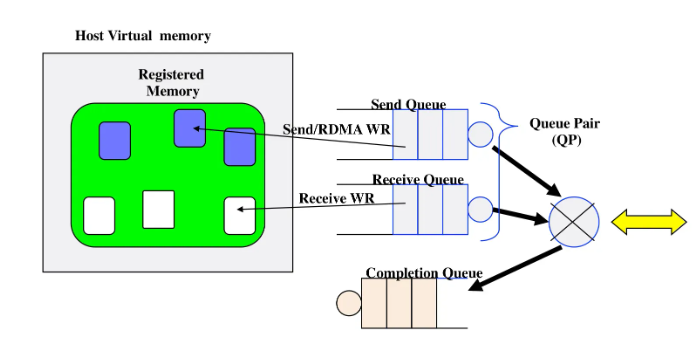
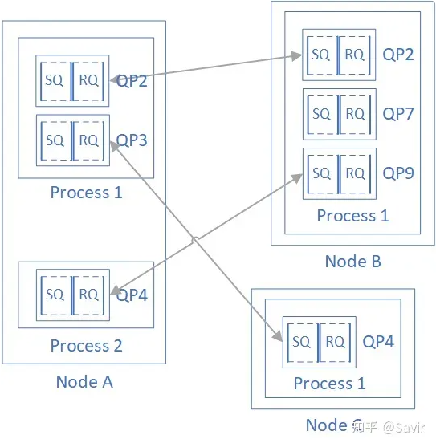
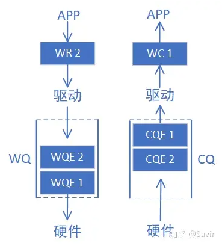
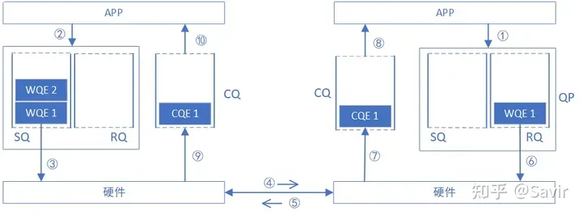

# RDMA 概念

## 缩略词

| 缩写 | 全写 | 中文含义 |
| ------ | ------ | ---------- |
| WQ | Work Queue | 工作队列 |
| WQE | Work Queue Element | 工作队列元素 |
| QP | Queue Pair | 队列对 |
| SQ | Send Queue | 发送队列 |
| RQ | Receive Queue | 接收队列 |
| SRQ | Shared Receive Queue | 共享接收队列 |
| CQ | Completion Queue | 完成队列 |
| CQE | Completion Queue Entry | 完成队列元素 |
| WR | Work Request | 工作请求 |
| WC | Work Completion | 工作完成 |
| PD | Protection Domain | 保护域 |
| MR | Memory Region | 内存区域 |
| SGE | Scatter/Gather Element | 散聚元素 |
| L_Key | Local Key | 本地密钥 |
| R_Key | Remote Key | 远端密钥 |
| QPN | Queue Pair Number | 队列对编号 |
| HCA | Host Channel Adapter | 主机通道适配器 |
| TCA | Target Channel Adapter | 目标通道适配器 |
| RNIC | RDMA Network Interface Card | RDMA 网卡 |
| CNA | Converged Network Adapter | 融合网络适配器 |
| RC | Reliable Connected | 可靠连接 |
| UC | Unreliable Connected | 不可靠连接 |
| RD | Reliable Datagram | 可靠数据报 |
| UD | Unreliable Datagram | 不可靠数据报 |
| FAA | Fetch and Add | 取并加 |
| CS | Compare and Swap | 比较并交换 |

**分类**：

- **队列族**：WQ、WQE、QP、SQ、RQ、SRQ、CQ、CQE、WR、WC
- **资源与安全**：PD、MR、SGE、L_Key、R_Key、QPN
- **硬件**：HCA、TCA、RNIC、CNA
- **传输模式**：RC、UC、RD、UD
- **原子操作**：FAA、CS

## 硬件设备

RDMA 的“零拷贝、低延迟、高吞吐”能力并非来自软件，而是由**网卡硬件**把传输协议处理与内存搬运从 CPU 卸载下来。不同网络/协议下，这类硬件有不同称谓，但核心职责一致：承载 QP/CQ/MR 等对象，并直接读写内存。

### HCA (Host Channel Adapter) —— 主机通道适配器

- **定义**：InfiniBand 网络中，将**主机节点**接入交换网络的通道适配器，是 IB 架构的核心网卡设备。
- **职责**：
  1. **协议卸载**：在硬件中实现 RDMA 传输层（可靠传输、流量控制、错误重传等），数据搬运全程不消耗 CPU。
  2. **资源载体**：QP、CQ、MR、PD 等 RDMA 对象实际创建并驻留在 HCA（或其关联内存）中，由 HCA 硬件维护状态并执行操作。
  3. **内存访问**：内部维护 VA→PA 映射，绕过 CPU 与操作系统直接读写系统内存。
- **软件接口**：向应用程序暴露 **Verbs API**——一套与传输无关的编程接口，应用通过它创建对象、下发 WR、轮询 CQ。
- **关联**：HCA 是“硬件”，Verbs 是“软件入口”，二者共同构成 RDMA 编程模型。

### TCA (Target Channel Adapter) —— 目标通道适配器

- **定义**：InfiniBand 早期规范中，用于 **I/O 目标设备**（如存储阵列、I/O 单元，而非运行完整主机栈的节点）的通道适配器。
- **与 HCA 的区别**：
  - **HCA** 面向主机，运行完整软件栈，经 Verbs API 由 CPU 控制；
  - **TCA** 面向目标设备，通常**不暴露 Verbs 接口**，由外部控制器/管理软件统一配置，功能相对精简。
- **现状**：随着技术演进，多数设备统一采用 HCA 或 RNIC 形态，独立 TCA 已较少单独出现，但作为规范术语仍被保留。

### RNIC (RDMA Network Interface Card) —— RDMA 网卡

- **定义**：支持 **RDMA over Ethernet**（iWARP 或 RoCE）的以太网网卡，把 RDMA 能力带到标准以太网络。
- **与 HCA 的关系**：HCA 是 InfiniBand 下的称谓，RNIC 是以太网下的称谓；二者是**同类硬件在不同网络中的对应物**，核心都是“把 RDMA 传输处理卸载到网卡”。
- **代表技术**：
  - **iWARP**：基于 TCP 实现 RDMA，对交换机无特殊要求，可在普通以太网上运行；
  - **RoCE（RDMA over Converged Ethernet）**：基于以太网链路层实现 RDMA，性能更高，但依赖无损以太网（PFC/ETS 等）支撑。
- **价值**：让数据中心在现有以太网基础设施上获得接近 InfiniBand 的零拷贝、低延迟、高吞吐收益。

### CNA (Converged Network Adapter) —— 融合网络适配器

- **定义**：在一张网卡上**融合多类存储与网络流量**（如 FC SAN、以太网 LAN、iSCSI、RDMA）的适配器，典型形态是支持 **FCoE（Fibre Channel over Ethernet）** 或 RoCE 的高带宽网卡。
- **核心思想**：用统一以太网络承载传统上相互独立的存储网（SAN）与数据网（LAN），减少适配器数量、简化布线。
- **与 RNIC 的关系**：RNIC 强调“RDMA 能力”，CNA 强调“协议融合”；支持 RoCE 的 CNA 本身往往就是一张 RNIC，二者是不同维度的描述。

## 重要概念

重要概念可分为两类理解：**资源与安全**回答“谁能访问哪块内存”，**队列族**回答“任务如何下发与完成”。

### 资源与安全 (Resource & Security)

#### PD (Protection Domain) —— 保护域

- **定义**：RDMA 中的安全隔离资源管理机制。
- **作用**：定义了一组内存区域和访问权限的集合。**QP 和 MR 必须绑定在同一个 PD 下**，HCA 才允许该 QP 操作该 MR 中的内存。
- **关联**：与 QP、MR 强关联，是它们能够协同工作的“权限容器”。

#### MR (Memory Region) —— 内存区域

- **定义**：应用程序内存区域的抽象描述，用于向 HCA 注册应用缓存。
- **内容**：起始地址、内存大小、访问权限（本地读/写、远程读/写等），并关联到所属的 **PD**。
- **钥匙（Key）**：
  - **L_Key（Local Key）**：供本地 HCA 访问该 MR 时使用。
  - **R_Key（Remote Key）**：供远端 HCA 访问该 MR 时使用（随 RDMA 请求报文发送）。
- **核心作用**：
  1. **地址转换（VA→PA）**：注册时，软件/驱动会在内存中维护虚拟地址到物理地址（或内存页表）的映射关系，并通知 HCA，使网卡能将 APP 提供的虚拟地址转换为真实物理地址以访问内存。
  2. **安全防护**：通过 Key 校验，防止本地非法虚拟地址或远端恶意请求越界访问系统关键内存。

#### SGE (Scatter/Gather Element) —— 散聚元素

- **定义**：用于描述 WR 中**一块具体的、待操作的内存片段**。
- **必含字段**：内存**起始地址（VA）**、**长度（Length）**，以及用于鉴权的 **L_Key 或 R_Key**。
- **用途**：多个 SGE 可组成一个列表，支持将一次大数据传输分散到多个不连续的物理/虚拟内存块，或从多个块中聚集数据。

### 队列族 (Queue Family)

#### WQ (Work Queue) —— 工作队列

- **定义**：**SQ 与 RQ 的统称**，是 RDMA 中承载工作请求（任务）的队列结构。
- **关系**：一个 QP 由一条 SQ 和一条 RQ 组成——SQ 存发送任务、RQ 存接收任务，二者合称该 QP 的工作队列（WQ）。
- **本质**：WQ 是逻辑概念，队列里真正存放、由硬件消费的是一条条 **WQE**。

#### WQE (Work Queue Element) —— 工作队列元素

- **定义**：工作队列中**实际存储、由硬件读取执行的队列元素**，是 WR 投入队列后的硬件形态。
- **与 WR 的区别**：
  - **WR（Work Request）**：软件 API 层构造的任务描述结构，由应用填写；
  - **WQE（Work Queue Element）**：驱动把 WR 转换并写入 WQ 后、供 HCA 直接消费的下发条目。
- **关系链**：一次 `Post`（投递）一个 WR → 驱动生成一个（或多个）WQE 入队 → 硬件消费 WQE 执行 → 完成后写一条 CQE 到 CQ。

#### QP (Queue Pair) —— 队列对

- **定义**：RDMA 通信的**基本对象**（而非节点本身），每个节点可创建多个 QP。
- **组成**：
  - **SQ（Send Queue）**：存放待发送的 WR（发送任务）。
  - **RQ（Receive Queue）**：存放待接收的 WR（接收任务）。
- **通信模式**：每个本地 QP 通常对接到一个远端 QP（典型 RC 可靠连接），也可用于多播（UD 模式）。
- **标识**：每个 QP 在 **HCA 设备内部**拥有唯一编号 **QPN**，远端通过“设备标识 + QPN”定位到本地的通信端点。
- **典型流程**：
  - 发送端：`Post Send` 将发送 WR 放入 SQ。
  - 接收端：`Post Receive` 将接收 WR 放入 RQ（预置接收缓存）。

#### SRQ (Shared Receive Queue) —— 共享接收队列

- **定义**：可供**多个 QP 共用**的接收队列，用于集中管理接收缓存。
- **解决的问题**：传统模型下每个 QP 都要各自预投递 RECV WR。连接（QP）数量很多时，接收缓存被摊薄、内存开销大，且难以预判哪条 QP 会先收到数据。
- **工作机制**：多个 QP 挂到同一个 SRQ 上，应用只需向 SRQ 投递一批 RECV WR；当任一关联 QP 收到 SEND 消息时，HCA 从共享池中摘取一个 WQE 接收数据。
- **适用场景**：连接数多、单连接消息稀疏的场景，可显著降低内存占用与预投递负担。
- **限制**：SRQ 支持 RC、UD、RD 模式，**不支持 UC**；且复用同一 SRQ 的 QP 必须属于同一 PD。

#### CQ (Completion Queue) —— 完成队列

- **定义**：用于存储 RDMA 操作**完成事件**的队列。
- **元素**：包含多个 **CQE（Completion Queue Entry）**，由硬件在执行完 WR 后写入。
- **关联关系**：**一个 CQ 可以关联多个 QP**（也可以一对一），用于统一管理多个 QP 的完成通知。
- **获取方式**：应用程序通过轮询（Poll）CQ，由驱动将 CQE 解析为软件可读的 **WC** 结构。

#### WR (Work Request) —— 工作请求

- **定义**：应用程序下发给硬件的任务描述结构。
- **内容**：操作类型（SEND/RECV/READ/WRITE）、数据源/目的地址、对应的 SGE 列表、操作码和控制标志等。
- **使用**：应用程序构造 WR 后，通过 `Post Send` 投入 SQ，或通过 `Post Receive` 投入 RQ，触发硬件执行。

#### WC (Work Completion) —— 工作完成

- **定义**：软件层面获取的**单次 RDMA 操作的完成结果**。
- **来源**：应用程序轮询 CQ 时，驱动读取硬件 CQE 并转换填充给应用的结构体。
- **内容**：操作状态（成功/失败）、操作类型、完成字节数、产生该完成的 QPN 和 WR_ID 等。

#### 一次 SEND-RECV 操作示例

1. 接收端 APP 以 WQE 的形式下发一次 RECV 任务到 RQ。
2. 发送端 APP 以 WQE 的形式下发一次 SEND 任务到 SQ。
3. 发送端硬件从 SQ 中拿到任务书，从内存中拿到待发送数据，组装数据包。
4. 发送端网卡将数据包通过物理链路发送给接收端网卡。
5. 接收端收到数据，进行校验后回复 ACK 报文给发送端。
6. 接收端硬件从 RQ 中取出一个任务书（WQE）。
7. 接收端硬件将数据放到 WQE 中指定的位置，然后生成“任务报告”CQE，放置到 CQ 中。
8. 接收端 APP 取得任务完成信息。
9. 发送端网卡收到 ACK 后，生成 CQE，放置到 CQ 中。（在步骤 5 之后立即触发）
10. 发送端 APP 取得任务完成信息。

## 传输模式

- **连接(Connected)服务**：对于基于连接的服务来说，每个QP（Queue Pair）都和另一个远端节点相关联。在这种情况下，QP Context中包含有远端节点的QP信息。在建立通信的过程中，两个节点会交换包括稍后用于通信的QP在内的对端信息。
- **数据报(Datagram)服务**：与面向连接恰好相反，QP不会跟一个唯一的远端节点绑定，而是通过WQE来指定目的节点。

- **可靠(Reliable)**：客户端与服务端通信报文需要进行应答的通信方式；
- **非可靠(Unreliable)**：客户端与服务端通信报文不需要进行应答的通信方式；

RDMA可以支持四种不同的传输模式：

- RC（Reliable Connected）：可靠连接，一个QP只和另一个QP相连，消息通过一个QP的发送队列可靠地传输到另一个QP的接收队列。RC连接很类似于TCP连接。
- UC（Unreliable Connected）：不可靠连接，一个QP只和另一个QP相连，连接是不可靠的，所以数据包可能有丢失。传输层出错的消息不会进行重传，错误处理必须由高层的协议来进行。
- RD（Reliable Datagram）：可靠数据报，一个QP和多个QP相连，消息通过akc/nak机制可靠的发送到多个QP。**不支持。虽然它是由规范定义的**
- UD（Unreliable Datagram）：不可靠数据报，一个 QP 可以和其它任意的 UD QP 进行数据传输和单包数据的接收。不保证按序性和交付性。交付的数据包可能被接收端丢弃。支持多播消息（一对多）。

## 传输操作

RDMA 传输操作根据远端 CPU 的参与程度，自然分为两类：

- **单边操作**完全不打扰远端 CPU，数据直达远端硬件并直接操作内存，远端应用进程毫无感知；
- **双边操作**则需要远端 CPU 事先投递好接收请求，本质上是一种配对的消息通信机制。下面分别对四种核心操作逐一拆解。

### RDMA WRITE —— 主动推送写入

**操作方向**：本地内存 → 远端内存（Push 模型）。

**远端 CPU 参与度**：完全为零。数据到达远端时，远端 HCA（网卡）直接根据指令将数据写入内存，远端操作系统和应用程序均不参与，也不产生任何中断通知。

**关键前置条件**：本地必须提前通过带外通道（如 TCP 握手）获取远端目标内存区域的**虚拟地址（VA）** 和 **R_Key**。这两个信息由远端在注册 MR 时生成，并主动告知本地。

**完整执行流程**：

1. **准备阶段**：本地应用程序构造一个 WR（工作请求），在其中填充本地数据所在的 SGE（含 L_Key）、远端的 VA 和 R_Key，以及操作码设置为 RDMA WRITE。
2. **下发任务**：应用程序调用 `Post Send`，将此 WR 放入 QP 的 SQ 中，硬件随即开始处理。
3. **本地发送**：本地 HCA 根据 SGE 中的 L_Key 校验权限，从本地内存中读取待发送的数据，封装成 RDMA 写请求报文发往远端。
4. **远端执行**：远端 HCA 收到报文后，解析出 VA 和 R_Key，校验 R_Key 权限无误，绕过 CPU 直接将数据写入指定的物理内存位置（HCA 内部维护 VA→PA 映射表）。
5. **确认与完成**：远端 HCA 操作成功后返回 ACK 确认报文给本地；本地 HCA 收到 ACK 后，在 CQ 中生成 CQE，应用程序轮询获得 WC，得知本次 WRITE 已成功完成。

**核心特点总结**：此操作用于“推送”数据，吞吐量极高，适合批量数据迁移（如 NVMe-oF 写 IO）。但远端应用无法感知数据何时到达，通常需要额外的通信机制（如再发一条 SEND 消息）来通知对端数据已就绪。

### RDMA READ —— 主动拉取读取

**操作方向**：远端内存 → 本地内存（Pull 模型）。

**远端 CPU 参与度**：同样为零。远端 HCA 负责读取自己的内存并打包回传，远端 CPU 全程无感。

**关键前置条件**：与 WRITE 一样，本地必须提前拿到远端源内存区域的 **VA** 和对应的 **R_Key**。

**完整执行流程**：

1. **准备阶段**：本地构造 READ WR，包含本地存放数据的 SGE（目标地址）、远端的源 VA 和 R_Key。
2. **下发任务**：调用 `Post Send` 将 WR 投入 SQ。
3. **发送请求**：本地 HCA 向远端 HCA 发出 RDMA READ 请求报文（该报文携带远端 VA 和 R_Key，但不携带用户数据）。
4. **远端响应**：远端 HCA 收到请求后，校验 R_Key 权限，从自己的内存中取出指定数据，封装成数据响应报文发回给本地。
5. **本地落盘**：本地 HCA 收到响应报文，将数据提取出来，根据 WR 中的本地 SGE 写入本地内存（需 L_Key 校验）。
6. **完成通知**：本地 HCA 在 CQ 中生成 CQE，应用轮询获得 WC。

**核心特点总结**：READ 操作包含“请求—响应”两个网络往返半程，因此端到端延迟通常略高于 WRITE。它的优势在于远端无需主动推送，本地可按需拉取，常用于避免远端发送缓冲区溢出或实现负载均衡的读取场景。

### SEND / RECV —— 双边消息收发

**操作方向**：双向消息传递（类比 Socket 的 send/recv）。

**远端 CPU 参与度**：**必须参与控制面**。远端必须事先调用 `Post Receive` 将空缓存块（RECV WR）投入 RQ，否则数据到达时无处存放，会引发丢包或重传。

**关键前置条件**：发送端只需要知道自己本地 MR 的 L_Key（保护数据源）；接收端需要提前注册好 MR 用于存放数据，并在 `Post Receive` 中填充好 SGE（含 L_Key）。

**完整执行流程（以一次 SEND 为例）**：

1. **接收端预备**：远端应用事先调用 `Post Receive`，将一个 RECV WR（含空缓存区的起始地址、长度和 L_Key）放入 QP 的 RQ 中，等待消息到达。
2. **发送端发起**：本地应用调用 `Post Send`，将 SEND WR（含待发送数据的 SGE 和 L_Key）放入 SQ。
3. **数据传输**：本地 HCA 读取数据，封装成 SEND 报文发往远端。
4. **远端匹配与写入**：远端 HCA 收到 SEND 报文后，自动从 RQ 中摘取一个已预投递的 RECV WR，将收到的数据填入该 WR 指定的缓存区（校验 L_Key）。
5. **完成通知（两端）**：
   - 远端 HCA 在 CQ 中生成 CQE，应用轮询得知数据已到达，可开始处理。
   - 本地 HCA 收到远端返回的 ACK（或硬件级确认）后，也在自己的 CQ 中生成 CQE，应用轮询得知发送任务已完成。

**核心特点总结**：SEND/RECV 是 RDMA 中的“握手”机制，安全可靠（不暴露远端内存地址），但接收方必须预先准备好缓存，且有“预投递不足”导致丢包的风险。常与单边操作配合使用——例如用 SEND/RECV 传递控制指令或通知数据到达，用 RDMA WRITE/READ 搬移海量数据。

### Atomic Operations —— 硬件原子操作

**操作方向**：远端内存的“读-改-写”一体化操作（Pull + Modify + Push）。

**远端 CPU 参与度**：依然为零，完全由远端 HCA 硬件在本地总线周期内原子完成。

**支持类型**（需高端网卡，如 Mellanox ConnectX 系列）：

- **Fetch & Add（FAA）**：读取远端指定地址的 64 位数值，将其加上一个给定的增量，再将新值写回原地址，并将旧值返回给本地。
- **Compare & Swap（CS）**：比较远端指定地址的值是否等于预期值，若相等则替换为新值，并返回操作前的旧值。

**关键前置条件**：必须拿到远端内存的 **VA + R_Key**，且要求远端目标地址**必须按 8 字节对齐**，否则硬件报错。此外，注册 MR 时需额外开启原子操作权限标志。

**执行流程（以 FAA 为例）**：

1. 本地构造原子操作 WR（含远端 VA、R_Key、增量值）。
2. 本地 HCA 发出原子请求报文到远端。
3. 远端 HCA 锁定对应内存缓存行（硬件级锁），读取旧值，执行加法，写回新值，解锁。
4. 远端 HCA 将旧值封装在响应报文中返回给本地。
5. 本地 HCA 将旧值填入本地指定的 SGE 缓存中，并产生 WC。

**核心特点总结**：原子操作用于解决分布式锁或网络计数器问题，避免传统“READ-MODIFY-WRITE”多次往返带来的延迟和竞态风险。但受限于硬件支持，且只能操作单一对齐的 64 位变量。
